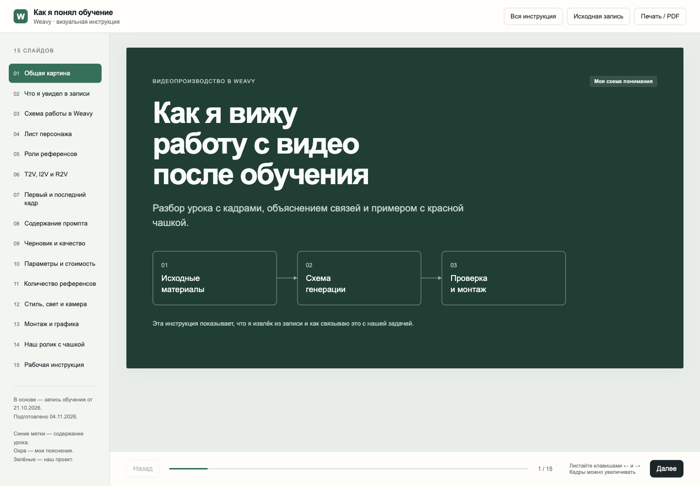

# Визуальная инструкция по Weavy

15 слайдов по записи обучения от 21 октября 2026 года: кадры урока, схемы подключения, режимы T2V / I2V / R2V, работа с черновиками и пример с красной чашкой.

Материал урока, авторская интерпретация и пример из нашего проекта отмечены отдельно.

## Просмотр

Откройте [инструкцию на GitHub Pages](https://webrelevant-dot.github.io/weavy-video-guide/) или скачайте `index.html` и откройте его в браузере. Кадры и короткий ролик встроены в файл.

Можно листать слайды, открыть всю инструкцию сразу, увеличить изображения и использовать список проверки перед генерацией.

Кнопка «Исходная запись» позволяет выбрать локальный файл обучения для переходов по отметкам времени. Полная запись не входит в репозиторий. Выбранное видео воспроизводится в браузере и никуда не загружается.

## О материале

Инструкция подготовлена 4 ноября 2026 года по расшифровке всей речи и выборочным кадрам с шагом 90 секунд. Это пересказ с пояснениями. Цены и параметры из урока относятся к моменту записи.
